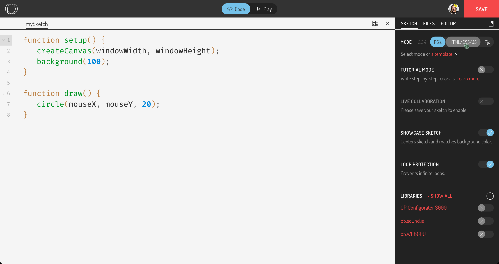
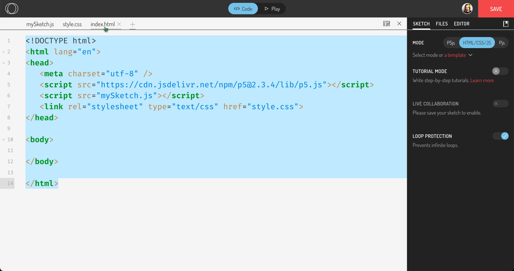
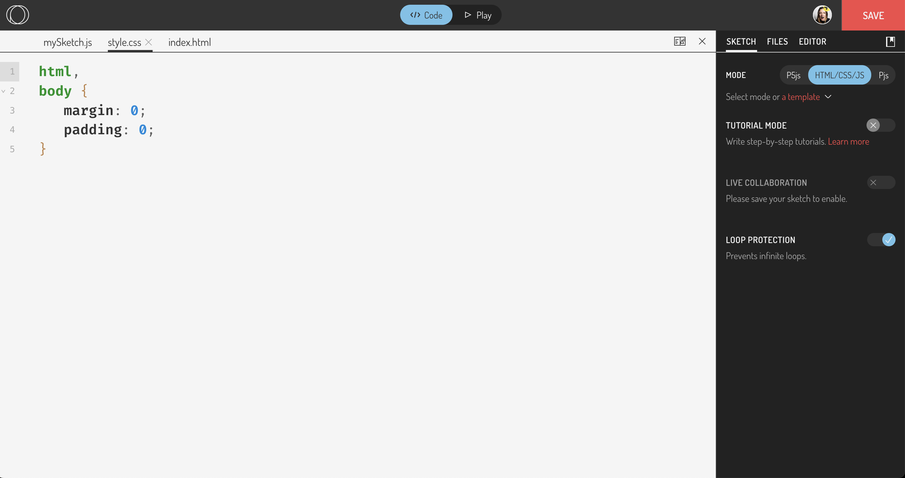

# Week 11: 11/6/2026

## Agenda

1. Housekeeping
2. Feedback Check-in
3. Assignment #7 Part 3
4. Review Session

## Housekeeping

1. Attendance
2. Questions from Lecture
	- Discussion question: what assumptions are you bringing to your game when defining how someone can interact with your project?
3. Upcoming assignment: #7 Part 4

## Feedback Check-in

Responding to feedback to make this class better!

If you have anything else that you would like to be addressed, you can always send me an email, book office hours, or fill out the [anonymous feedback form](https://docs.google.com/forms/d/e/1FAIpQLSc8FX_px9x8SS8IUec6-4Gb_RErzMowldphd0jkZOZOCvg6Bw/viewform?usp=dialog). 

## Assignment #7 Part 3

1. Go wash your hands
2. Set up your computer to receive feedback:
	- [Option 1] using pen + paper 
	- [Option 2] using the [digital whiteboard](https://www.tldraw.com/f/86lhTImE-Ax-oCWkzJj_z?d=v0.0.708.747.w6tvg5ejxzjasTo6dgqLa) :


3. Take ~5 minutes:
	- Write the instructions on how to interact with your prototype. 
	- Write 2-3 technical and/or conceptual questions you need answers for.
4. ~20 minutes:
	- Go around the room science fair style and see what your peers have made
	- Write notes of feedback, questions, confusion
	- If you can answer any of your peers questions, please note your answers
## Review Session 

From last class whiteboard, and the questions you asked just now, what do we need to review?

## Introduction to the DOM

| coding glossary       |                                                                                                                                                                                                                      |
| --------------------- | -------------------------------------------------------------------------------------------------------------------------------------------------------------------------------------------------------------------- |
| HTML                  | Hyper-Text Markup Language is a way of "tagging" text to define the structure of a web page                                                                                                                          |
| element / tag         | in HTML, a specific item on the page, eg. `<p>`, `<a>`, `<div>`                                                                                                                                                      |
| CSS                   | Cascading Style Sheets allow styling of HTML tags                                                                                                                                                                    |
| selector              | in CSS, the thing we are grabbing on the html page                                                                                                                                                                   |
| property              | in CSS, thing that we want to change about the specific element                                                                                                                                                      |
| value                 | in CSS, what the property changes the appearance to                                                                                                                                                                  |
| Document Object Model | the way that javascript perceives the structure and style of the web page<br><br>Document = HTML document (ie `index.html`)<br>Object Model = a JavaScript object that refers to the HTML document, using `document` |
### A Lite Intro to HTML / CSS

Hyper-Text Markup Langauage (HTML) isn't a programming language, but a way to taxonimize (organize) words on a page.

#### Comments

The syntax of a comment in HTML is `<!-- -->`. 

```html
<!-- this is a comment in HTML -->
```
#### The HTML Tag

HTML follows a particular structure. The first tag we always use in an HTML file is `<html>`. All of our code will be written between the opening and closing tags. Every HTML tag can also be called an `element`, or the thing that exists on the page.

```html
<!-- opening -->
<html>
<!-- closing -->
</html>
```

#### Looking at the HTML file in OpenProcessing

In the OpenProcessing Editor, change the mode to `HTML/CSS/JS`



If we open up the HTML file, we can see the web code:



`<html>` has two "child" elements, meaning tags that are nested between the opening and closing tags.

- `<head>` gives us extra data about the webpage, but it isn't seen inside the page
- `<body>` is the actual content of the page

Other html tags (not a definitive list):

- `<p>` - paragraphs
- `<em>` - emphasis / italics
- `<strong>` - bold
- `` - images, use `src` attribute to determine paths to files
- `<a>` - links, uses `href` attribute to go to another file or site

Take a look at the [full list of html tags on the docs](https://developer.mozilla.org/en-US/docs/Web/HTML/Reference/Elements).

### CSS

Cascading style sheets determine the style, or what the web page looks like. This is a series of rules that look very similar to objects with properties. They are given via a selector.

```css
/* this is a comment in css */

p {
	/* selector, or which tag/element we want to apply the style to*/
	color: blue; /* rule in key:value pair */
}
```

We can see a [full list of css properties](https://developer.mozilla.org/en-US/docs/Web/CSS/Reference/Properties) in the documentation.

Looking at the default `.css`:



### DOM

The Document Object Model is the way that Javascript is able to perceive and reference HTML code to make changes to it.


This enables us to programatically add items to the DOM using p5.js: https://p5js.org/reference/#DOM

## Extra Review Materials

- Allison Parrish [Browser Controls](https://creative-coding.decontextualize.com/browser-controls/)
- Coding Train [HTML/CSS/DOM Playlist](https://www.youtube.com/watch?v=URSH0QpxKo8&list=PLRqwX-V7Uu6bI1SlcCRfLH79HZrFAtBvX) (videos 8.1-8.16)