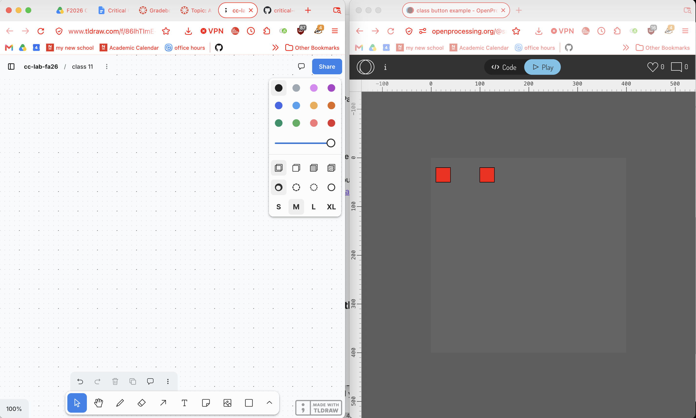

# Week 11: 11/6/2026

## Agenda

1. Housekeeping
2. Feedback Check-in
3. Assignment #7 Part 3
4. Review Session

## Housekeeping

1. Attendance
2. Questions from Lecture
	- Discussion question: what assumptions are you bringing to your game when defining how someone can interact with your project?
3. Upcoming assignment: #7 Part 4

## Feedback Check-in

Responding to feedback to make this class better!

If you have anything else that you would like to be addressed, you can always send me an email, book office hours, or fill out the [anonymous feedback form](https://docs.google.com/forms/d/e/1FAIpQLSc8FX_px9x8SS8IUec6-4Gb_RErzMowldphd0jkZOZOCvg6Bw/viewform?usp=dialog). 

## Assignment #7 Part 3

1. Go wash your hands
2. Set up your computer to receive feedback:
	- [Option 1] using pen + paper 
	- [Option 2] using the [digital whiteboard](https://www.tldraw.com/f/86lhTImE-Ax-oCWkzJj_z?d=v0.0.708.747.w6tvg5ejxzjasTo6dgqLa) :

3. Take ~5 minutes:
	- Write the instructions on how to interact with your prototype. 
	- Write 2-3 technical and/or conceptual questions you need answers for.
4. ~20 minutes:
	- Go around the room science fair style and see what your peers have made
	- Write notes of feedback, questions, confusion
	- If you can answer any of your peers questions, please note your answers
## Review Session 

From last class whiteboard, and the questions you asked just now, what do we need to review?